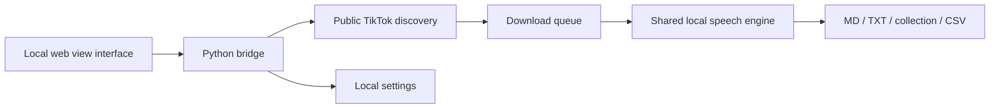

# Architecture

TikTok Transcriber uses Python for media processing and a local HTML interface rendered
by the system's web view: WebView2 on Windows, WebKit on macOS, Qt WebEngine on
Linux. It has no application server.

| Module | Responsibility |
|---|---|
| `src/app.py` | Window, settings, bridge, gallery jobs, batched UI events |
| `src/desktop.py` | Per-system folders, opening files, sleep prevention, theme, locale, single instance |
| `src/tiktok_public.py` | Anonymous public embed discovery and playable media |
| `src/tiktok_core.py` | Feed pagination, downloads, engine selection, queues, exports |
| `src/natural_asr.py` | Native Qwen runtime, VAD, language boundaries, cancellation |
| `src/localization.py` / `src/i18n.js` | Python and browser translations |
| `src/controls.js` | Shared accessible pickers |
| `src/ui.html` | Application views and layout |
| `src/vendor` | Nas design system and Orbi renderer |

## Media and queues

A single-video URL stays a single-video job. A profile embed helps discover
the account identifier; yt-dlp then paginates the real public feed. Covers and
metadata can appear while discovery continues. A preview count is never used
as the complete account size.

Downloads and recognition use separate queues. Healthy consumers drain queued
work during normal shutdown. Cancellation discards unfinished work and avoids
exporting partial transcripts. A stalled or failed worker must be reported.

The native model is shared and serialized to avoid duplicate model memory.
Whisper uses its own CUDA/CPU backend. The selected engine remains loaded during
the session; changing the model replaces it when required.

## Text and exports

The speech engine supplies words and punctuation. The formatter groups existing
sentences and pauses into paragraphs; it does not rewrite the transcript.
Per-video files retain metadata. Collections and CSV indexes are rebuilt from
the files on disk, including earlier runs. A redo replaces the selected video's
output and removes its obsolete alternate format.

## Interface and settings

Bridge events are batched rather than issuing a separate DOM update for every
download callback. Expensive work runs outside the interface thread. Settings
updates use a lock and atomic replacement of the disk snapshot.

The Nas kit provides dark/light semantic tokens, tactile controls, integer-scale
pixel artwork, and reduced motion. Product branding belongs to TikTok Transcriber; the Nas
signature identifies its author and Orbi remains a supporting mascot.
